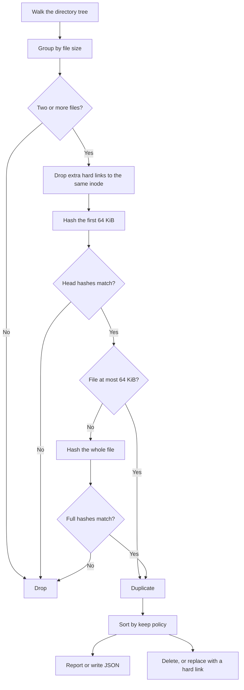

# Duplicate File Finder

## Introduction

Disks fill up with copies. Photos get duplicated across folders, downloads pile up, projects keep old copies of the same asset. This tool walks a directory tree, groups files whose content is identical, and then lets you clean up: delete the extras or replace them with hard links that take no extra space.

Content is compared, never names. Renamed copies and copies in other folders still land in the same group. There is no config file, no database, and no install step.

What it does:

- Three-pass comparison (size, first 64 KiB, full SHA-256), so most files are never read end to end
- Scan-only by default; `-d` deletes copies, `-l` replaces them with hard links
- Deterministic keep rule, so the same tree always produces the same plan
- Filters for size range, glob patterns, and hidden entries
- Honest JSON output for scripting
- Safe on Windows: skips junctions and symlinks, handles read-only files, refuses to prompt when stdin is not a terminal



## Dependencies

[](https://www.python.org/)
[](LICENSE)
[]()

Python 3.8 or newer. Everything comes from the standard library: `argparse`, `hashlib`, `os`, `json`, `fnmatch`, `stat`, `time`, `collections`, `concurrent.futures`. No third-party packages, no build step, no configuration file.

## Project structure

```
Find_duplicate_files/
├── Find_duplicate_files.py    # the whole tool
├── test_find_duplicates.py    # unittest suite
├── README.md                  # English
├── README.zh-CN.md            # Chinese
└── LICENSE
```

## Usage

Download the script, or clone the repository:

```powershell
git clone https://github.com/anjuxi/Find_duplicate_files.git
cd Find_duplicate_files
python Find_duplicate_files.py . -v
```

Common commands:

```powershell
python Find_duplicate_files.py                     # scan the current directory
python Find_duplicate_files.py D:\photos -v        # scan a directory and print stats
python Find_duplicate_files.py -m 1024 -M 10485760 # only 1 KiB to 10 MiB
python Find_duplicate_files.py -x '*.tmp' -x node_modules
python Find_duplicate_files.py --ignore-hidden
python Find_duplicate_files.py -j 8                # 8 hashing threads
python Find_duplicate_files.py -k newest           # keep the newest copy instead
python Find_duplicate_files.py --json report.json
python Find_duplicate_files.py -d                  # delete copies, asks first
python Find_duplicate_files.py -l -y               # hard-link copies, no prompt
```

### Options

| Option | Meaning |
| --- | --- |
| `root` | Directory to scan, `.` by default |
| `-m, --min-size` | Skip files smaller than this many bytes |
| `-M, --max-size` | Skip files larger than this many bytes |
| `-x, --exclude` | Glob to exclude; repeatable, and matching directories are not descended into |
| `--ignore-hidden` | Skip dot names and Windows hidden files |
| `--follow-links` | Follow symlinks and junctions instead of skipping them |
| `-j, --jobs` | Hashing threads; 0 picks `min(32, CPU+4)`, 1 runs serially |
| `-k, --keep` | Keep the `oldest` (default), `newest`, or `shortest` path in a group |
| `-d, --delete` | Delete every copy except the kept one |
| `-l, --hardlink` | Replace every copy with a hard link to the kept one |
| `-y, --yes` | Skip the confirmation prompt |
| `--json` | Write JSON to a file; `-` puts JSON on stdout and the report on stderr |
| `-v, --verbose` | Print progress and a timing line |

### Output

```
== 重复组 1: 3 个文件，每个 29 B，可释放 58 B！
   D:\demo\a\report.txt  [保留]！
   D:\demo\b\report-copy.txt！
   D:\demo\c\report-copy2.txt！

——————————————————————————————————————
✅ 共 1 组重复，2 个冗余副本，可释放 58 B！
```

The `[保留]` line is the file that stays. Groups are sorted by reclaimable space, so the top of the output is where `-d` or `-l` saves the most.

JSON looks like this:

```json
{
  "root": "D:\\demo",
  "files_scanned": 4,
  "summary": { "groups": 1, "redundant": 2, "wasted": 58 },
  "groups": [
    {
      "size": 29,
      "wasted": 58,
      "files": [
        { "path": "D:\\demo\\a\\report.txt", "mtime_ns": 1700000000000000000, "keep": true },
        { "path": "D:\\demo\\b\\report-copy.txt", "mtime_ns": 1700000001000000000, "keep": false }
      ]
    }
  ]
}
```

### Safety notes

- Keeping is deterministic. Within a group, `-k` decides the order and the first entry wins, so the same tree always produces the same plan.
- Without `-y` you get one prompt. If stdin is not a terminal, or reads empty (the Windows NUL device still reports `isatty()` as true), the run stops with code 2.
- Read-only files get their attribute cleared and are retried. One failure does not abort the rest; failures are counted and the exit code becomes 1.
- Hard links are created under a temporary name and moved into place, so a failed link never leaves you without the copy. Cross-volume and FAT/exFAT targets fail cleanly.
- A file whose size or mtime changes while hashing is dropped from this run.
- Symlinks and junctions are skipped by default. Junctions are not reported by `is_symlink()`, so the reparse-point attribute is checked directly.

### Edge cases

| Case | Result |
| --- | --- |
| Empty files | Grouped together with 0 bytes reclaimable; use `-m 1` to hide them |
| Hard links | Only one path per inode is considered |
| Symlinks | Skipped unless `--follow-links` is passed |
| Unreadable files | Reported on stderr and skipped |
| Same size, different content | Dropped by the head hash or the full hash |

### Exit codes

| Code | Meaning |
| --- | --- |
| 0 | Done, including "no duplicates" and a cancelled prompt |
| 1 | At least one delete or hard link failed |
| 2 | Bad arguments, missing directory, JSON write failure, or no way to confirm |

### Performance

Windows 11, NVMe SSD, Python 3.11, warm cache, best of three runs. Numbers from one machine, treat them as rough.

| Scenario | 1 thread | Default threads |
| --- | --- | --- |
| 1260 files / 123.7 MiB, 120 duplicate pairs around 100 KiB | 88–104 ms | 93–122 ms |
| 120 files of 1 MiB sharing a 64 KiB header | 133–139 ms | 51–67 ms |

Large files gain from threads; many small files do not, because the pool costs more than the hashing. That is why one pool is created per scan instead of per group, and why batches under 1 MiB of total read size stay on the main thread.

### Tests

```powershell
python -m unittest -v test_find_duplicates
```

Twelve cases covering cross-directory grouping, same-size and same-header false positives, size filters, exclusion and hidden files, empty files, hard-link counting, the delete and hard-link actions, JSON on stdout, missing paths, and symlink loops.

## Contributing

Issues and pull requests are welcome. Keep the tool dependency-free, add a test when behavior changes, and run the suite before sending a pull request. Bug reports are most useful with the command line, the Python version, and the output of `-v`.

## Contact

谙弆悕博士 (Ailan Anjuxi)

📫 Email: anjuxi.ME@outlook.com

📞 SIP: sip:anjuxi@sip.linphone.org

Released under the MIT License.
