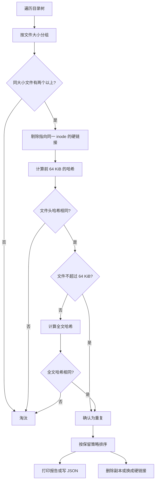

# 重复文件查找工具

## 项目介绍

磁盘里的副本总是越攒越多：同一个文件在几个目录各存一份，下载目录里躺着重复的安装包，老项目里还留着几版同样的素材。这个工具递归扫描目录树，把内容完全相同的文件归成一组，然后由你决定怎么处理——删掉多余的副本，或者换成不占额外空间的硬链接。

只比内容，不看名字。改过名的、挪到别的目录的副本照样能认出来。没有配置文件，没有数据库，也不用手动安装。

主要功能：

- 三级比对（文件大小、前 64 KiB、全文 SHA-256），大部分文件不会被完整读取
- 默认只扫描；`-d` 删除副本，`-l` 换成硬链接
- 保留规则是确定的，同一棵目录树每次跑出来的方案一致
- 支持大小区间、glob 排除、隐藏文件过滤
- 输出 JSON，方便接到脚本里
- 针对 Windows 做了处理：跳过目录联接和符号链接，能删只读文件，stdin 不是终端时拒绝交互删除



## 依赖说明

[](https://www.python.org/)
[](LICENSE)
[]()

需要 Python 3.8 及以上。用到的模块都在标准库里：`argparse`、`hashlib`、`os`、`json`、`fnmatch`、`stat`、`time`、`collections`、`concurrent.futures`。没有第三方包，不需要编译，也没有配置文件。

## 项目结构

```
Find_duplicate_files/
├── Find_duplicate_files.py    # 全部功能
├── test_find_duplicates.py    # 单元测试
├── README.md                  # 英文
├── README.zh-CN.md            # 中文
└── LICENSE
```

## 使用说明

把脚本下载下来，或者直接克隆仓库：

```powershell
git clone https://github.com/anjuxi/find_duplicate_files.git
cd find_duplicate_files
python Find_duplicate_files.py . -v
```

常用命令：

```powershell
python Find_duplicate_files.py                     # 扫当前目录
python Find_duplicate_files.py D:\photos -v        # 扫指定目录并打印统计
python Find_duplicate_files.py -m 1024 -M 10485760 # 只看 1 KiB 到 10 MiB
python Find_duplicate_files.py -x '*.tmp' -x node_modules
python Find_duplicate_files.py --ignore-hidden
python Find_duplicate_files.py -j 8                # 8 个线程算哈希
python Find_duplicate_files.py -k newest           # 改成保留最新的一份
python Find_duplicate_files.py --json report.json
python Find_duplicate_files.py -d                  # 删除副本，先问一次
python Find_duplicate_files.py -l -y               # 换成硬链接，不再问
```

### 参数

| 参数 | 说明 |
| --- | --- |
| `root` | 扫描目录，默认 `.` |
| `-m, --min-size` | 跳过小于该字节数的文件 |
| `-M, --max-size` | 跳过大于该字节数的文件 |
| `-x, --exclude` | glob 排除，可重复使用；命中目录时整棵子树都不进 |
| `--ignore-hidden` | 跳过点号开头的文件和 Windows 隐藏文件 |
| `--follow-links` | 跟随符号链接和目录联接，默认跳过 |
| `-j, --jobs` | 哈希线程数，0 取 `min(32, CPU+4)`，1 为串行 |
| `-k, --keep` | 组内保留 `oldest`（默认）、`newest` 或 `shortest` |
| `-d, --delete` | 删除每组除保留项外的副本 |
| `-l, --hardlink` | 把副本换成指向保留项的硬链接 |
| `-y, --yes` | 跳过确认 |
| `--json` | 结果写文件；用 `-` 输出到 stdout，报告改走 stderr |
| `-v, --verbose` | 打印进度和耗时 |

### 输出

```
== 重复组 1: 3 个文件，每个 29 B，可释放 58 B！
   D:\demo\a\report.txt  [保留]！
   D:\demo\b\report-copy.txt！
   D:\demo\c\report-copy2.txt！

——————————————————————————————————————
✅ 共 1 组重复，2 个冗余副本，可释放 58 B！
```

标 `[保留]` 的那行会留下。分组按可释放空间从大到小排，输出最上面几组就是 `-d` 或 `-l` 最划算的地方。

JSON 长这样：

```json
{
  "root": "D:\\demo",
  "files_scanned": 4,
  "summary": { "groups": 1, "redundant": 2, "wasted": 58 },
  "groups": [
    {
      "size": 29,
      "wasted": 58,
      "files": [
        { "path": "D:\\demo\\a\\report.txt", "mtime_ns": 1700000000000000000, "keep": true },
        { "path": "D:\\demo\\b\\report-copy.txt", "mtime_ns": 1700000001000000000, "keep": false }
      ]
    }
  ]
}
```

### 注意事项

- 保留项是确定的。组内先按 `-k` 排序，第一项留下，同一棵树每次跑出来的方案都一样。
- 不加 `-y` 只问一次。stdin 不是终端，或者读出来是空的（Windows 的 NUL 设备 `isatty()` 照样返回真），直接以退出码 2 退出。
- 只读文件会先去掉只读属性再删。单个文件失败不影响后面的，最后统计失败数并以退出码 1 结束。
- 硬链接先建在临时名下再替换过去，链接失败时副本还在。跨卷、FAT/exFAT 上会失败，原文件保持不动。
- 算哈希时文件的大小或修改时间变了，这一轮就丢弃该文件，不拿过期结果去删东西。
- 符号链接和目录联接默认跳过。目录联接的 `is_symlink()` 返回假，所以单独检查重解析属性。

### 特殊情况

| 情况 | 结果 |
| --- | --- |
| 空文件 | 归为一组，可释放 0 字节；不想看就加 `-m 1` |
| 硬链接 | 一个 inode 只算一个路径 |
| 符号链接 | 不加 `--follow-links` 就跳过 |
| 无权限的文件 | 错误打到 stderr，继续扫 |
| 同大小不同内容 | 由文件头哈希或全文哈希淘汰 |

### 退出码

| 退出码 | 含义 |
| --- | --- |
| 0 | 正常结束，包括没找到重复和用户取消确认 |
| 1 | 至少有一个删除或硬链接失败 |
| 2 | 参数错误、目录不存在、JSON 写不进去、没法交互确认 |

### 性能

测试环境是 Windows 11、NVMe SSD、Python 3.11，热缓存，三次取最好。只代表这一台机器。

| 场景 | 单线程 | 默认多线程 |
| --- | --- | --- |
| 1260 个文件 / 123.7 MiB，含 120 对约 100 KiB 的重复 | 88–104 ms | 93–122 ms |
| 120 个 1 MiB 文件，前 64 KiB 相同 | 133–139 ms | 51–67 ms |

文件大的时候多线程有用；文件小的时候线程池开销比哈希还大。所以整轮只建一个线程池，一批文件总共读不到 1 MiB 时也不走线程池。

### 测试

```powershell
python -m unittest -v test_find_duplicates
```

12 个用例：跨目录分组、同大小与同文件头的误判、大小过滤、排除与隐藏文件、空文件、硬链接计数、删除和硬链接两种动作、JSON 输出、路径不存在、符号链接环路。

## 贡献指南

问题和 Pull Request 都欢迎。提交前请保持零第三方依赖，改行为要补测试，并把测试集跑一遍。提 bug 时附上命令行、Python 版本和 `-v` 的输出，定位会快很多。

## 联系作者

谙弆悕博士（Ailan Anjuxi）

📫 邮箱：anjuxi.ME@outlook.com

📞 SIP电话：sip:anjuxi@sip.linphone.org

本项目基于 MIT 许可证发布。
